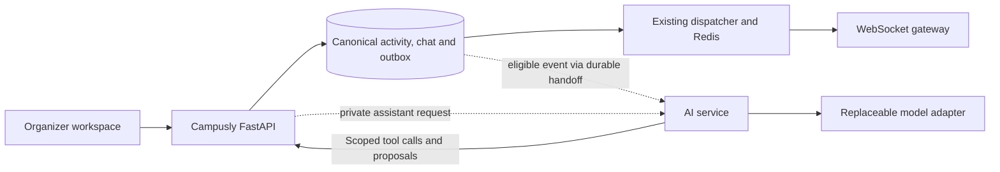
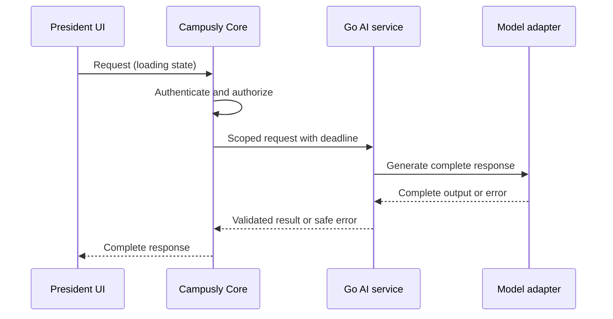

# Proposed local architecture

Solid core messaging edges exist. All AI components and interactions are proposals. Core owns the integration endpoints and organizer UI. This repo owns orchestration, a versioned client, synthetic counterpart, evaluation and worker lifecycle. The gateway stays in core until the Cloud phase.

Propose versioned request, proposal, receipt and event schemas. Include event ID, version, organization, group and canonical source reference. Reject unknown versions. Core filters eligibility before handoff. Check live visibility again before retrieval and posting. Keep context scoped to actor and audience; never copy a group's timeline into personal history. A personal, conversation, group or organization memory has its own owner, readers, provenance and deletion policy. Promotion between scopes needs review.

The existing dispatcher claims outbox rows with SKIP LOCKED and records Redis publication. A durable AI consumer needs separate progress. Discuss a core-owned job record committed with the eligible event and lease/ack APIs. On timeout reclaim the lease. Retry with bounded backoff, quarantine exhausted jobs, key bot posts by source identity and return the original receipt after uncertain success. Never hold a business transaction open during inference.

For later scaling, keep request handlers stateless and partition worker capacity independently of HTTP and sockets. Persist claims and receipts outside process memory, bound concurrency and share provider quotas across replicas. Compare one, two and four workers on identical synthetic arrivals, recording queue age, completion latency, quota errors, duplicates and recovery after worker loss. Formal measurement needs separate authorization.

## Incremental delivery (ADR 0002)

The diagram describes eventual boundaries, not A1 requirements. A1 needs only president-scoped UI, Core, AI service and model adapter with one complete non-streamed response and basic failure/loading states. Use a synthetic counterpart for standalone tests. Persistence, reads, confirmed actions and personal memory follow individual slices. Durable group handoff/worker design is reviewed before D2, not required for A1. Independent service boundaries and single-host deployment remain. [ADR 0003](../decisions/0003-go-bounded-requests.md) selects Go and bounded synchronous personal requests; Eino is narrowly adopted for the model/tool/agent boundary, while provider, concrete state, queue and exact contract choices remain open.

## Initial personal request boundary (proposed implementation)

A1 uses net/http and context, with a deterministic fake adapter for credential-free tests. Hosted inference requires separate approval. Propagate cancellation and deadlines, bound concurrent work and retries, and validate output. Do not hold a core database transaction during inference. No personal job queue or streaming. Later group jobs use a separately designed durable asynchronous handoff; ordinary messaging never waits for AI. AI01 proposed default limits; exact contracts and limits remain A1 decisions.
