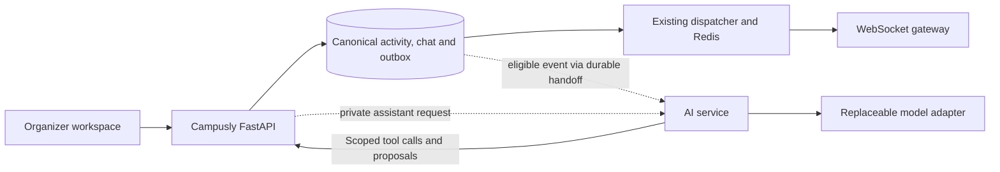
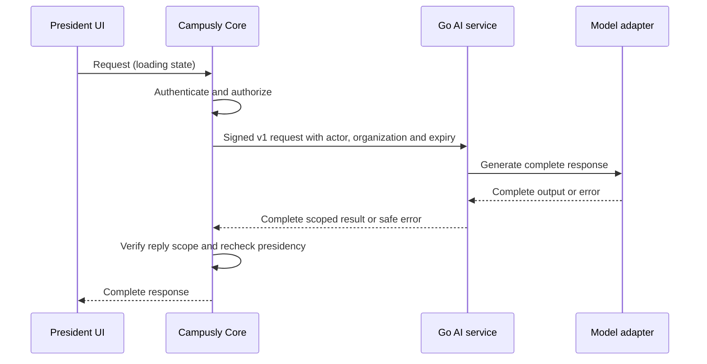
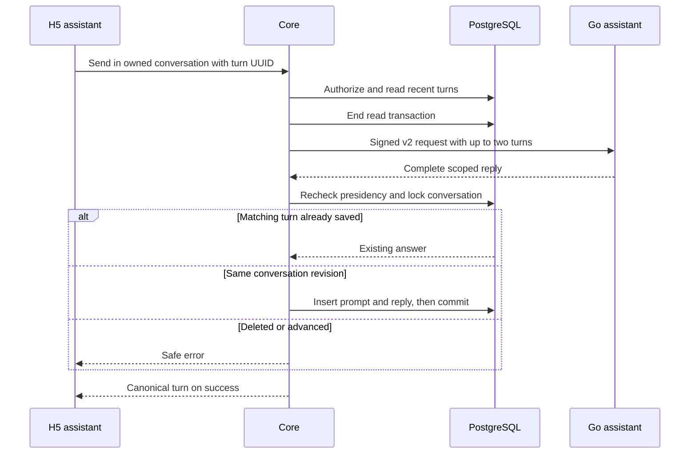
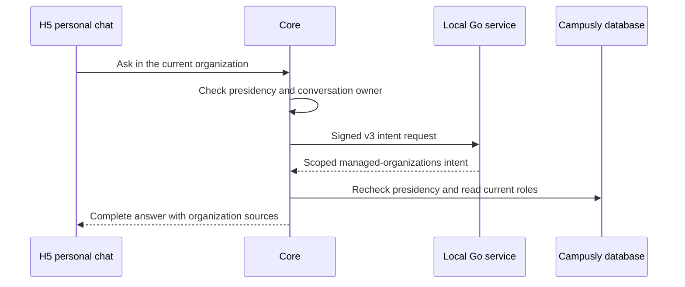
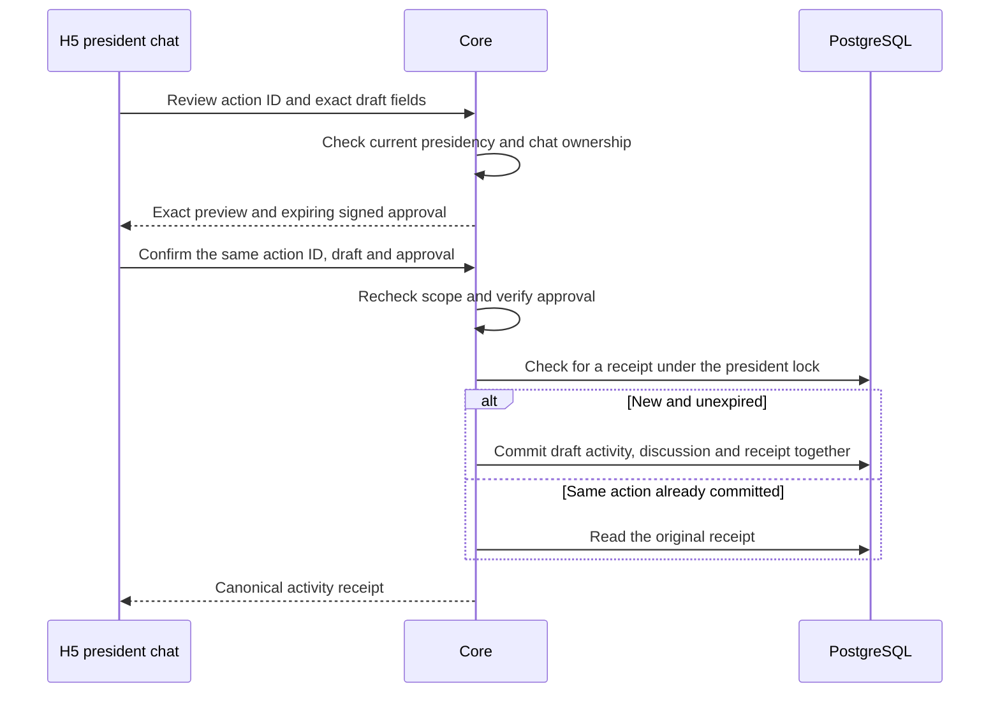
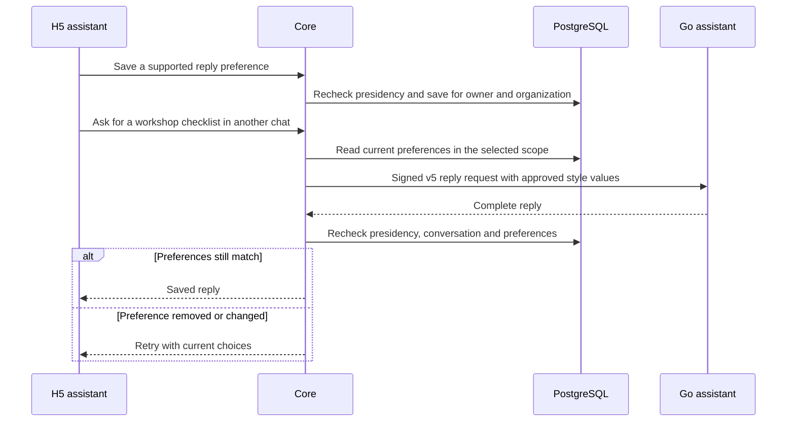

# Proposed local architecture

Solid core messaging edges exist. The personal request path below is implemented as a local prototype. The other AI links are proposals. Core owns the integration endpoints and organizer UI. This repo owns orchestration, a versioned client, synthetic counterpart, evaluation and worker lifecycle. The gateway stays in core until the Cloud phase.

Propose versioned request, proposal, receipt and event schemas. Include event ID, version, organization, group and canonical source reference. Reject unknown versions. Core filters eligibility before handoff. Check live visibility again before retrieval and posting. Keep context scoped to actor and audience; never copy a group's timeline into personal history. A personal, conversation, group or organization memory has its own owner, readers, provenance and deletion policy. Promotion between scopes needs review.

The existing dispatcher claims outbox rows with SKIP LOCKED and records Redis publication. A durable AI consumer needs separate progress. Discuss a core-owned job record committed with the eligible event and lease/ack APIs. On timeout reclaim the lease. Retry with bounded backoff, quarantine exhausted jobs, key bot posts by source identity and return the original receipt after uncertain success. Never hold a business transaction open during inference.

For later scaling, keep request handlers stateless and partition worker capacity independently of HTTP and sockets. Persist claims and receipts outside process memory, bound concurrency and share provider quotas across replicas. Compare one, two and four workers on identical synthetic arrivals, recording queue age, completion latency, quota errors, duplicates and recovery after worker loss. Formal measurement needs separate authorization.

## Incremental delivery (ADR 0002)

The diagram describes eventual boundaries, not A1 requirements. A1 needs only president-scoped UI, Core, AI service and model adapter with one complete non-streamed response and basic failure/loading states. Use a synthetic counterpart for standalone tests. Persistence, reads, confirmed actions and personal memory follow individual slices. Durable group handoff/worker design is reviewed before D2, not required for A1. Independent service boundaries and single-host deployment remain. [ADR 0003](../decisions/0003-go-bounded-requests.md) selects Go and bounded synchronous personal requests; Eino is narrowly adopted for the model/tool/agent boundary, while provider, concrete state, queue and exact contract choices remain open.

## A1 local personal request boundary

A1 uses net/http and context, with a deterministic fake adapter for credential-free tests. Hosted inference requires separate approval. Propagate cancellation and deadlines, bound concurrent work and retries, and validate output. Do not hold a core database transaction during inference. No personal job queue or streaming. Later group jobs use a separately designed durable asynchronous handoff; ordinary messaging never waits for AI. See [ADR 0004](../decisions/0004-personal-assistant-boundary.md) for the contract and limits.

## A3 stored turns

The conversation is owned by the student within the organization. A
database cascade removes its turns on hard delete. The Go service
processes the signed context in memory for the duration of the call.
See [ADR 0005](../decisions/0005-personal-conversation-retention.md).

## B1 live organization context

The v3 intent exchange has a one-second Core budget. A plain chat intent
uses the existing v2 model exchange. Campusly source cards disappear when
the user switches chats or reloads the transcript. Core rebuilds the answer
on the next question using the then-current authorization. Go receives no
organization rows and has no credentials to query Core.

## B5 confirmed activity creation

The confirmation path does not call Go. Receipts contain the actor,
organization, action ID, target and keyed payload fingerprint. Deleting
a private chat removes its transcript. The operational audit stays with
Core and is scoped to the actor and organization.

B7 uses the same confirmation path for official notices. The payload
names the canonical discussion and Core checks membership and president
capability before committing the public notice, its outbox events and
the receipt. Manual discussion paths use the default transaction
behavior. H5 opens the confirmed post by its message ID.

B8 uses that same room and receipt path for a public text message.
It sends the president's approved text through the existing chat
service and creates only its ordinary message event. Private
inquiries stay in the discussion's existing private composer.

## C1 recent context

Core reads a bounded suffix of whole turns from the owned transcript
and releases its read transaction before inference. The signed v4
reply contract checks the number of turns and UTF-8 text size again in
Go. The full saved transcript stays in Core. See
[ADR 0007](../decisions/0007-personal-memory.md).

## C2–C3 personal preferences

The intent request for live Campusly reads carries the prompt only.
Using or editing a preference does not confer access to any activity or
discussion. See [ADR 0007](../decisions/0007-personal-memory.md).
